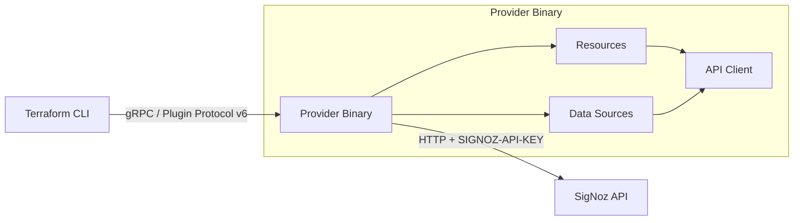

# Project Architecture

## Overview

A Terraform provider for managing SigNoz observability resources (alerts and dashboards) as infrastructure-as-code. Built on the **Terraform Plugin Framework** (protocol v6) in Go, it communicates with the SigNoz REST API over HTTP using an access token for authentication.

## System Diagram

## Core Components

| Component | Package | Purpose |
|-----------|---------|---------|
| Entry point | `main.go` | Starts `providerserver.Serve` with debug flag support |
| Provider | `signoz/provider.go` | Configures auth, endpoint, HTTP settings; registers resources and data sources |
| API Client | `signoz/internal/client/` | HTTP client with retry (heimdall), timeout, and `SIGNOZ-API-KEY` header auth |
| Attributes | `signoz/internal/attr/` | Shared Terraform schema attribute name constants |
| Models | `signoz/internal/model/` | Go structs for alert and dashboard JSON payloads |
| Resources | `signoz/internal/provider/resource/` | CRUD lifecycle for `signoz_alert` and `signoz_dashboard` |
| Data Sources | `signoz/internal/provider/datasource/` | Read-only lookup for `signoz_alert` and `signoz_dashboard` |
| Utilities | `signoz/internal/utils/` | Shared helpers (JSON normalization, diffing) |

## Managed Resources

| Terraform Type | API Endpoint | Operations |
|----------------|-------------|------------|
| `signoz_alert` | `/api/v2/rules` | Create, Read, Update, Delete |
| `signoz_dashboard` | `/api/v1/dashboards` | Create, Read, Update, Delete |
| `signoz_alert` (data) | `/api/v2/rules/{id}` | Read |
| `signoz_dashboard` (data) | `/api/v1/dashboards/{id}` | Read |

## Configuration

The provider accepts config via HCL attributes or environment variables:

| Attribute | Env Variable | Default | Description |
|-----------|-------------|---------|-------------|
| `access_token` | `SIGNOZ_ACCESS_TOKEN` | *(required)* | API authentication token |
| `endpoint` | `SIGNOZ_ENDPOINT` | `http://localhost:3301` | SigNoz API base URL |
| `http_timeout` | `SIGNOZ_HTTP_TIMEOUT` | `35` (seconds) | Per-request timeout |
| `http_max_retry` | `SIGNOZ_HTTP_MAX_RETRY` | `10` | Max retry count with constant backoff |

HCL values override env vars; env vars override defaults.

## Technology Stack

| Layer | Technology |
|-------|-----------|
| Language | Go 1.25 |
| Plugin SDK | `terraform-plugin-framework` v1.14 |
| HTTP Client | `gojek/heimdall` v7 (retry + backoff) |
| Doc Gen | `terraform-plugin-docs` (tfplugindocs) |
| Release | GoReleaser (cross-platform binaries) |
| CI | GitHub Actions (test + release workflows) |
| Registry | `registry.terraform.io/signoz/signoz` |

## Key Design Decisions

- **Plugin Framework over SDKv2**: Uses the newer `terraform-plugin-framework` for type-safe schema definitions and native diagnostics, rather than the legacy `terraform-plugin-sdk/v2`.
- **Heimdall HTTP client**: Provides automatic retry with constant backoff (5s interval, 1s jitter) — critical for resilience against transient SigNoz API failures.
- **Dashboard as opaque JSON**: Dashboard `data` is stored as a normalized JSON string rather than decomposed into typed attributes, reflecting the dashboard spec's complexity and variability.
- **Env-var fallback chain**: Provider config follows Terraform conventions — HCL attribute → environment variable → built-in default — making CI/CD integration straightforward.
